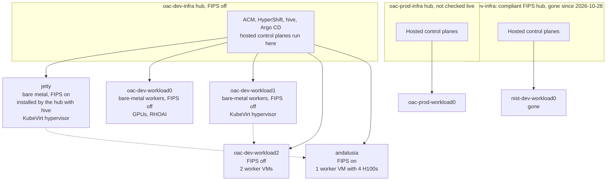
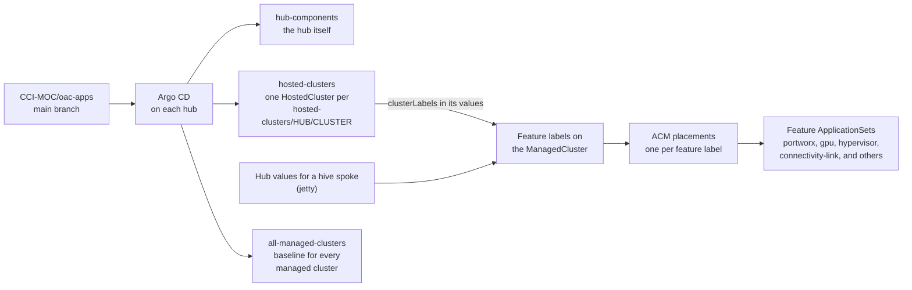
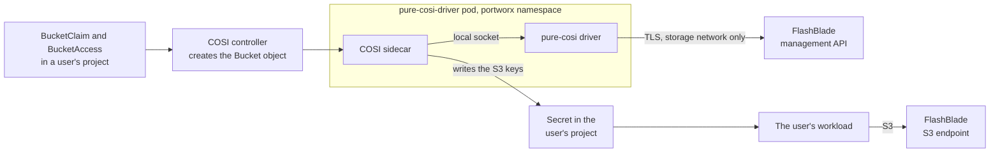
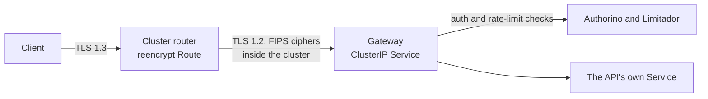

# Handoff: open work and next steps

*2026-11-06. Start here if you are picking this up. [README.md](README.md)
has the background and how it got here; this file is what is still open.*

Where it stands: jetty proved the stack can be made compliant, with GPUs
in containers and VMs. A FIPS test hub (nist-dev-infra) then built a
compliant workload cluster from oac-apps charts, and was retired on
2026-10-28. The compliance charts are going into CCI-MOC/oac-apps one PR at
a time. The next milestone is a replacement compliant hub, built from the
runbook by someone other than its author.

Node hardening does not cover add-on operators: six installed operators are
not flagged FIPS-compliant, and none has a recorded decision yet
([§3](#3-operators-without-a-fips-claim)).

Older decision and prerequisite lists are still current and are not
repeated here: [BUILD.md](BUILD.md) P1 to P11 (what a compliant hub needs,
and from whom) and [PLAN.md](PLAN.md#open--what-remains-what-it-needs-and-from-whom)
(decisions, vendor questions, blocked items).

## Clusters today

| Cluster | What it is | State |
|---|---|---|
| jetty | Bare metal, FIPS on, OCP 4.22.14 | The test bed for everything below, and a KubeVirt hypervisor for oac-dev-infra (andalusia). Its internal registry is normally `Removed`; turn it on only to build a test image, then back off. No test leftovers as of 2026-11-06 |
| oac-dev-infra | OAC dev hub, FIPS **off** | Hosts andalusia. jetty is its hive spoke |
| andalusia | Hosted cluster on oac-dev-infra, one GPU VM worker on jetty | FIPS on: rebuilt 2026-11-04 with `fips: true` (the live HostedCluster has `spec.fips: true`). No feature labels, so it gets only the baseline every managed cluster gets, with no COSI or Portworx. Its hub is not compliant, so it is a FIPS test cluster, not a compliant one |
| oac-dev-workload0 | Shared dev cluster, FIPS **off**, RHOAI 3.5 | Not ours; has the Service Mesh 3.5 operator for RHOAI |
| nist-dev-infra, nist-dev-workload0 | The FIPS test hub and its workload cluster | **Gone** (2026-10-28). Rebuild from [nist-dev-infra/RUNBOOK.md](nist-dev-infra/RUNBOOK.md) |

Admin kubeconfigs are in AWS Secrets Manager. None is in this repo, and
none should be.

### How the clusters relate

Checked live on 2026-11-07, except oac-prod-infra, which is from oac-apps
only. A hosted cluster's control plane runs as pods on its hub; only its
workers run elsewhere. Solid arrows: the hub creates and manages the
cluster. Dotted arrows: where a hosted cluster's worker VMs run.

### How a cluster gets its components

Everything comes from CCI-MOC/oac-apps (`main`) through Argo CD on each
hub. The hub's own components come from `hub-components`. Every managed
cluster gets the `all-managed-clusters` baseline. Anything more depends on
the cluster's feature labels (`massopen.cloud/feature-<name>: "true"`): an
ACM placement matches each label, and its ApplicationSet deploys that
feature's charts.

What that gives each cluster on oac-dev-infra today (2026-11-07):

| Cluster | Feature labels | Components beyond the baseline |
|---|---|---|
| andalusia | none | none |
| oac-dev-workload2 | none | none |
| jetty | `connectivity-link`, `hypervisor` | Connectivity Link; `hypervisor-cluster` and patch-operator |
| oac-dev-workload1 | `hypervisor`, `metallb`, `portworx`, `rossoctl`, `user-workloads`, `virtualization` | Portworx and pure-cosi, MetalLB, OpenShift Virtualization, `hypervisor-cluster`, and others |
| oac-dev-workload0 | `gpu`, `metallb`, `portworx`, `rossoctl`, `user-workloads`, `virtualization` | The GPU operators, RHOAI, Portworx and pure-cosi, and others |

The baseline is 12 components, including cert-manager, external-secrets,
`cluster-certificates`, `user-projects` and the monitoring settings.
Compliance charts will come from a separate route, the hub's compliance
marker (`hosted-clusters/<hub>/compliance.yaml`), not from feature labels.

## Open pull requests

| PR | What | State (2026-11-07) | Next step |
|---|---|---|---|
| [oac-apps #198](https://github.com/CCI-MOC/oac-apps/pull/198) | File Integrity Operator chart | Review required | Reviews |
| [oac-apps #214](https://github.com/CCI-MOC/oac-apps/pull/214) | RHCOS hardening from git | Review required. tzumainn's question on how the rules are regenerated is answered | Reviews |
| [oac-apps #217](https://github.com/CCI-MOC/oac-apps/pull/217) | Nightly etcd backups of a hub | Approved by larsks; review still required | tzumainn |
| [oac-apps #230](https://github.com/CCI-MOC/oac-apps/pull/230) | Project Grafana without the operator | Changes requested by larsks: the mode should not be configurable. Retested on jetty after the route rename | Decide whether all Grafana moves off the operator, then drop the option; then the follow-ups under Grafana below |
| [oac-apps #231](https://github.com/CCI-MOC/oac-apps/pull/231) | Lets the `acm` chart set guardrails for ACM's namespaces (uses #216) | Approved by tzumainn; review still required | larsks. The chart deploys to hubs only, so where the add-on namespace's guardrails go on managed clusters is still open |
| [pure-cosi #15](https://github.com/CCI-MOC/pure-cosi/pull/15) | Integration tests against a real FlashBlade | No reviews yet | naved001 |
| [oac-apps #232](https://github.com/CCI-MOC/oac-apps/pull/232) | FIPS COSI images on `nist-dev-infra` only | Review required | naved001, tzumainn. Changes nothing until that hub is rebuilt (see Object storage below) |

Merged and in effect: #195 (the hub compliance marker), #196, #215, #218,
#197 (the compliant-hub admission policy chart; no cluster deploys it yet),
#208 (no GPUs for pods that did not ask), #212, #213, #216 (the
`namespace-guardrails` library chart; no cluster sets guardrails yet), #219,
#229 and the others listed in [README.md](README.md). Merged in pure-cosi
but not yet deployed: #13 and #14 (the FIPS builds). No ApplicationSet deploys the
compliance charts yet: once they merge, one PR wires them to #195's marker
(BUILD.md P1).

## Open work, by area

### 1. The replacement compliant hub

- **Next:** someone other than the author builds it on new nodes from
  [NEW-HUB-RUNBOOK.md](NEW-HUB-RUNBOOK.md), with etcd encryption from
  install. Neither runbook has been run end to end.
- **Needs first:** the charts merged and wired (above), and the
  prerequisites in BUILD.md P1 to P11.
- **Disk encryption (P10)** needs a tested method. TPM-based NBDE on the
  FC830s is [MOC-issues #672](https://github.com/CCI-MOC/MOC-issues/issues/672):
  estimated at 5 to 8 days for a test; **do not start until the issue's
  owner says to proceed** (it says to estimate only). The R440 workers
  have a TPM fault (#670). oac-infra supports only TPM (`tpmv2`); a Tang
  option is possible if TPM stays blocked.

### 2. Audit and alert destination (most urgent gap)

Audit records last hours on a node, and nothing alerts on a new scan
failure. Needs a destination from the security or SIEM owners. PLAN.md B1
and B2, BUILD.md P9.

### 3. Operators without a FIPS claim

[tests/operator-fips-inventory.md](tests/operator-fips-inventory.md) has the
full record, including check-payload scans of each one's images. `verify.sh
-t t18` fails on any new operator without the flag.

| Operator | Next step | With |
|---|---|---|
| Cluster Observability Operator | Its images are FIPS builds; the CSV flag is wrong. Get it corrected | COO team |
| Portworx | Images are not FIPS builds. Ask for FIPS builds of PX-CSI and the operator | Pure |
| NVIDIA GPU Operator | NVIDIA's FIPS driver images need NVIDIA AI Enterprise; a free NGC key cannot pull them | NVIDIA |
| Grafana operator | Replaced on compliant clusters by #230 (see Grafana below) | - |
| patch-operator | Its four Patches can become ACM ConfigurationPolicies (tested on jetty) or server-side apply ([inventory](tests/operator-fips-inventory.md#patch-operator-checked-2026-11-07)). Draft PR for `node-labels` first, as an idea for the team | larsks, tzumainn |
| group-sync-operator | Not needed on compliant hubs, which take groups from Keycloak's `groups` claim. It runs only on `oac-dev-infra`. On the rebuilt `nist-dev-infra`, test that an SSO group grants access ([inventory](tests/operator-fips-inventory.md#group-sync-operator-checked-2026-11-07)) | - |

### 4. FIPS module validation

The nodes run OpenSSL FIPS provider `3.0.7-cda111b5812c30d4`, a security
build after the certified one (#4857). Confirm with the RHEL crypto team
that it is the submission in CMVP Comment Resolution. Re-review
[tests/fips-cmvp-certificates.md](tests/fips-cmvp-certificates.md) at every
upgrade.

### 5. Object storage (COSI)

All three parts now have FIPS builds, and on jetty (FIPS on) they ran a
full bucket lifecycle against the FlashBlade (inventory, "Object storage").

How a bucket request flows. The controller and sidecar act through the
Kubernetes API; only the driver talks to the FlashBlade, over the storage
network.

- pure-cosi #13 and #14 are merged and released as `v0.2.0`, which publishes
  all three images. The manifests in that tag still name the old driver and
  the upstream controller and sidecar, so oac-apps has to set the images.
- oac-apps #232 sets them in the `nist-dev-infra` overlay only, so any
  breakage stays off the other clusters. That hub is gone, so no live cluster
  gets these images from oac-apps until it is rebuilt. The shared base stays
  at `v0.1.2`, whose `k8s/` is identical to `v0.2.0`.
- Later releases: update the `newTag` values in that overlay.
- The published images passed on jetty, applied by hand with a jetty-only
  overlay rather than through Argo: the driver integration tests, and a bucket
  claim from create to delete with read-write and read-only access.
- **Still to test, on the rebuilt hub:** S3 reads and writes with the issued
  keys, including that read-only keys cannot write. Jetty could not reach the
  S3 endpoint. Also run `check-payload` on the published sidecar and
  controller: it passed on earlier builds of the same Dockerfiles, not on
  these digests.
- `tests/integration` (pure-cosi #15) reruns the driver's FlashBlade and FIPS
  checks in any image.
- **The FlashBlade's identity is not checked**: its management certificate
  is the factory self-signed one. A FlashBlade admin installs one from MOC's
  CA with `10.3.11.50` in it; then pure-cosi verifies it (`verify_ssl`).
- Testing note: the FlashBlade management address is reachable only from
  pods on the storage network (NetworkAttachmentDefinition), not from the
  nodes or the default pod network.

### 6. Connectivity Link

**Status (checked 2026-11-07): installed on jetty, not used yet.**

- **How it's deployed:** the `connectivity-link` chart (oac-apps #227,
  merged 2026-11-05). On each hub, the `connectivity-link-clusters`
  ApplicationSet selects clusters labelled
  `massopen.cloud/feature-connectivity-link`. Only jetty has the label, on
  oac-dev-infra. Its Application, `jetty-connectivity-link`, is Synced and
  Healthy.
- **What runs on jetty:** the Connectivity Link operator 1.4.3, Authorino
  1.4.3, Limitador 1.4.2 and the DNS operator 1.4.2, all from
  redhat-operators and all flagged FIPS-compliant. The Kuadrant instance is
  Ready. The `openshift-default` GatewayClass is accepted, and the ingress
  operator's istiod is running in `openshift-ingress`.
- **Not used yet:** the chart's `gateways` list is empty, so there are no
  Gateways or policies. Putting a real API behind it is deferred until the
  KubeVirt work settles.
- **Tested by hand before #227, not yet through Argo:** a Gateway behind
  the router (ClusterIP Service, reencrypt Route, a NetworkPolicy that
  admits only the router), and a RateLimitPolicy that limited one client
  while another still got through. The first gateway added to `gateways`
  should be checked the same way.
- **Not on any compliant hub:** nist-dev-infra has the placement but no
  labelled cluster, and it is gone anyway.

How a request reaches an API behind Connectivity Link. A NetworkPolicy
lets only the router reach the gateway.

**Gateway TLS 1.3: optional, not needed.** No operator needs it, and
nothing is blocked. Under FIPS, the built-in Istio's gateways do TLS 1.2
with FIPS ciphers (ECDHE, AES-GCM). Clients never reach a gateway directly:
they connect to the router with TLS 1.3, and the router reencrypts to the
gateway, so TLS 1.2 is used only on that internal hop. TLS 1.3 there would
matter only if a gateway were exposed to clients directly, or if a
requirement named TLS 1.3 for internal hops. Neither applies now.

For the record, if it is ever wanted (tested on jetty, inventory
"Gateways"): a second Istio from Service Mesh 3.5 (Istio 1.31,
`fips-140-3`) does TLS 1.3, and Connectivity Link policies work on it. As
shipped, its istiod does not start on FIPS nodes (`GODEBUG=fips140=only`
conflicts with Red Hat Go's OpenSSL mode), it accepts only P-384 for key
exchange, and running it beside the ingress operator's istiod has no
support statement. Not worth pursuing unless the need changes.

### 7. Grafana without the operator

#230 adds `defaultGrafana.operator: false` to `user-projects`, tested on
jetty with RHEL's Grafana package
([GRAFANA-FIPS-IMAGE.md](GRAFANA-FIPS-IMAGE.md)). After it merges:

- Build the image once (the hub is suggested) and push it to a private
  registry. Which quay.io organization, and who holds its robot account,
  is undecided.
- Switch compliant clusters to the new mode, and stop deploying the
  `grafana-operator` chart there (today `all-managed-clusters` sends it to
  every cluster).
- Accept, or not, that editable projects start fresh: RHEL ships Grafana
  10.2, which cannot read an 11.x database.

### 8. GPUs and VMs

Passthrough, MIG and pod-in-VM are proven ([vms/gpu/README.md](vms/gpu/README.md)).
Pod-in-VM benchmarks used the AI UAT Harness (Ahmed Sanaullah).

- One tenant per GPU node until cross-tenant NVLink is answered.
- RDMA on jetty: not pursued for now (only 2 of 6 ConnectX ports linked, no
  SR-IOV or network operator).

### 9. Smaller recorded gaps

- The shared kubeadmin login: an SSO admin group first, then remove it.
- NetworkPolicies for the hub's own namespaces, for production: measure
  each namespace's traffic first ([nist-dev-infra/RUNBOOK.md](nist-dev-infra/RUNBOOK.md) §7).
- The cluster-wide proxy: a POA&M item, none planned.
- Hosted cluster etcd on FlashBlade NFS: accepted for the test only;
  production gets local disks.
- Storage for workload clusters (Portworx and NFS over TLS): on
  nist-dev-workload0 this needed a fix to the Portworx chart's NNCP (it
  would retake the default route), an opt-out of object-storage-proxy, and
  a pod address range from the network admins.

## Questions waiting on someone

New since PLAN.md's vendor table:

| Ask | Of |
|---|---|
| Correct COO's `fips-compliant` flag; is COO supported on FIPS clusters? | COO team |
| Is provider `3.0.7-cda111b5812c30d4` the CMVP submission in Comment Resolution? | RHEL crypto team |
| Low priority, only if gateway TLS 1.3 is ever needed (§6): fix istiod with `fips-140-3` on FIPS nodes; is a second Service Mesh beside the ingress operator's supported? | Service Mesh team |
| FIPS builds of PX-CSI and the Portworx operator | Pure |
| NVIDIA AI Enterprise access for the FIPS driver images | NVIDIA |
| A FlashBlade management certificate from MOC's CA | FlashBlade admins |
| A private quay.io organization for the Grafana image | Registry owner |
| Go-ahead for the NBDE test (#672) | The issue's owner |

## Recurring work

- Run `tests/verify.sh` before and after every change
  ([tests/README.md](tests/README.md)).
- At every upgrade: re-review the FIPS certificate record and
  [PRIVILEGED-WORKLOADS.md](PRIVILEGED-WORKLOADS.md); re-check disabled or
  exempted rules after operator upgrades.
- Rescan operator images with `tests/fips-image-scan.sh` when an operator
  changes. Run it on a cluster, never on a laptop.

## Things that will catch you

- **Building images on jetty:** the registry is `Removed`. Set it to
  `Managed` with `emptyDir`, wait for the openshift-apiserver rollout, and
  create image streams only after that (otherwise builds fail with
  `InvalidOutputReference`). Set it back to `Removed` afterwards.
- **Go builds on many-core nodes** hit the build pod's process limit; cap
  them with `GOFLAGS=-p=4` and `GOMAXPROCS=4`.
- **OLM reverts `oc rollout restart`** on operator-owned deployments; delete
  the pod instead.
- **Before importing a cluster to a hub,** check every placement that would
  select it, not just the intended one. jetty's first import pulled in
  12 components with prune.
- **Under FIPS:** sshd refuses ed25519 keys (use ECDSA); Grafana 10's
  default POST queries are refused by the monitoring tenancy port (use GET);
  PyPI's `cryptography` wheel bundles its own non-FIPS OpenSSL (build it
  from source on UBI).
- **COSI CRDs applied by hand** need the `api-approved.kubernetes.io`
  annotation that upstream's kustomization adds.
- **A Service Mesh test leaves CRDs behind:** removing the operator leaves
  its `sailoperator.io` CRDs, `trafficextensions.extensions.istio.io` and
  the `istio` and `istio-remote` GatewayClasses. The other 14 `istio.io`
  CRDs belong to the ingress operator; leave them.

## Who to ask

| Topic | Who |
|---|---|
| oac-apps generally | tzumainn |
| oac-apps repo layout, compliance chart upstreaming | larsks |
| Observability: Prometheus, COO, Loki, Grafana | schwesig |
| Keycloak, OIDC, MOC SSO | computate |
| FlashBlade, Portworx, pure-cosi | naved001, DanNiESh |
| AI UAT Harness | Ahmed Sanaullah |
| NBDE scope (#672) | hpdempsey |
